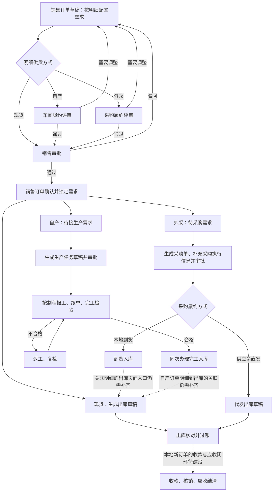

# 从销售订单开始的全流程设计、操作与关联

核对日期：2026-09-28。依据当前前后端代码和已实施迁移，历史设计文档只作背景。本文件区分“业务应当如何串联”和“当前系统做到哪里”，不把已有页面等同于业务闭环。

更新：随后已完成自产主产品／外采到货的原销售明细关联发货入口、来源保存和批次过账／冲销。下文的这两项“断点”描述属于本轮建设前的盘点，最新操作与边界见《原销售明细关联发货操作与建设记录-20260928.md》。收款闭环仍待建设。

## 1. 总体关系

销售订单记录客户需求。订单明细确定产品／配置、数量、销售价格、客户交期和供货方式。自产、外采先履约评审，再提交销售审批。确认后明细分别进入现货、生产、采购分支。

一笔订单可同时有三类明细，三条分支并行。页面的流程导航只提供入口，不是“生产完还必须采购”的顺序。

## 2. 销售订单怎么录

入口：“订单与生产交付 → 销售订单 → 新建订单”。

先从客户档案选择客户；没有档案可在页面新增客户。再填订单日期、客户要求交期和备注，逐行确定需求。每行独立记录产品、规格／配置、单位、数量、单价、供货方式和明细交期。

| 供货方式 | 销售录入时的操作 | 当前约束 |
| --- | --- | --- |
| 现货 | 从可售库存中选择产品，填写数量、价格 | 选到产品不代表已经预留或扣减库存；发货时仍检查实际库存 |
| 自产 | 点击配置入口，复用“新建生产任务单”的表单，选择产线、产品和配置；保存到订单明细 | 这一步保存需求配置，不等于下达一张执行生产任务单 |
| 外采 | 填写产品名称、规格／型号、品牌、技术、验收、包装和交付要求 | 保存客户采购需求，不提前生成正式采购单 |
| 待确定 | 暂存草稿后继续完善 | 未确定供货方式不能送评／提交销售审批 |

自产的配置表单与独立生产建单共用组件，但提交目的不同：销售中保存明细需求；独立任务入口创建生产任务。

当前销售页面已要求选择或新增客户档案；后端保存契约仍允许客户 ID 为空，服务端强制约束尚需统一。当前代码还允许单价为空。因此不能认为系统已经强制“完整客户档案＋价格审核＋合同核实”全部完成。

## 3. 订单确认前：履约评审和销售审批

1. 销售完善明细后，点击“保存并送履约评审”。
2. 车间在“履约评审 → 车间·自产”查看自产配置、数量和交期，提交“可按要求执行”或“需要销售调整”。
3. 采购在对应外采页核对规格、供应可行性和交期，提交同样的结论。
4. 要调整的，销售继续修改草稿并重新评审。修改产品配置、数量或交期后，原意见失效。评审人建议日期不会直接改掉客户要求日期。
5. 所有需要评审的明细有有效通过意见后，销售提交订单审批。
6. 销售审批人通过后，订单成为已确认；驳回则回草稿，并保留审批历史。

履约评审期间订单仍是草稿，评审意见是独立状态。销售订单状态为：草稿 → 待审批 → 已确认；待审批可驳回到草稿。当前默认未强制建单人与审批人分离。

| 控制 | 主要解决的问题 |
| --- | --- |
| 车间／采购履约评审 | 需求是否能按配置、数量、交期执行 |
| 销售订单审批 | 是否批准对客户的这份销售需求与承诺 |
| 生产任务审批 | 是否批准执行该生产任务 |
| 采购订单审批 | 是否批准该供应商、采购价格、数量和执行安排 |

这些控制分别针对不同业务事实。订单确认不是免除下游执行单据审批。

## 4. 确认后的三个执行分支

### 4.1 现货

在已确认订单的现货明细点击“生成出库”，选择仓库、本次数量，生成出库草稿。产品、客户、价格和订单明细关联随单带入。可分批。

草稿不扣库存。核对后过账，系统校验库存、扣减余额并写流水。取消草稿释放该订单明细的待发占用数量；过账后有冲销能力。订单明细的待发数量计算会计入已经生成的草稿，避免同一订单反复超量生成。

这不等于跨订单的库存预留：订单录入／确认阶段没有完整的库存占用机制。当前出库办理权限是销售管理权限，不能宣称已有独立仓库审批与严格岗位分离。

### 4.2 自产

入口：“待接生产需求”。仅显示已确认、自产、未接单且未暂停的需求。

车间查看已确认配置后接单，系统带入订单明细信息生成生产任务草稿，保留销售明细 ID；当前一条自产明细对应一张任务，不支持随意重复建单。任务提交审批、批准下达后才进入执行。

生产任务的制程依据产线产品／配置的现有匹配规则带出，正常接单不用再录一套配置或重新手选制程。

执行中的两种记录分开：

- 生产人员按工序报工，可多次累计完成数量。整单进度按必做工序的完成情况计算。
- 跟单人员记录跟进内容、预计完成日期、延期原因和负责人。跟单记录不替代报工，也不改变客户承诺交期。

报工错误通过冲正留下反向记录，需要相应权限和原因。累计各工序报工数量不能当成整机完成台数。

全部必做工序完成后进入人工检验。质检／获授权跟单人员在“检验入库”核对产出、产品档案、仓库和数量：合格时检验与入库同一事务提交；不合格时指定返工起始工序和要求，返工后复检。当前合格检验要求覆盖本任务全部计划数量；不支持把存在不合格品的整单直接作为合格单提交。

入库产生关联生产任务的产出、入库明细、成品批次和库存记录。没有库存产品身份的产出，必须在检验页选择对应产品档案后才能入库。

**当前断点：**生产任务到完工入库已有关系，但销售订单的出库草稿接口只直接支持现货／外采明细。自产入库后能够成为库存，尚不能据此认定其发货已经自动关联回原自产订单明细。若在普通出库页面独立开单，不能保证销售订单能看清该明细已发数量。

### 4.3 外采

入口：销售明细“办理采购”或“采购订单 → 待采购需求”。采购人员选择确认后的外采需求，建立采购草稿。

销售确认的名称、规格、单位和数量带入并受保护；采购人员补供应商、采购价格、预计到货、履约方式和仓库等执行信息。提交采购审批，批准后才办理实际到货／直发。

本地到货型：关联库存产品档案，到货时填写实际数量，可分批收货；库存增加后应从原销售明细办理销售出库。当前后端支持对应外采明细生成本地出库草稿，但销售页面按钮仍主要对现货明细开放，采购页已有的直接出库入口是代发。因此外采到货后的关联出库页面入口还需补齐，不能通过修改已确认供货方式或另开无关联单据来掩盖断点。

供应商直发型：生成并核对代发出库草稿，过账记录交付事实，不扣本地库存；冲销也不回补本地库存。

当前一条外采明细只允许一张有效采购单，可分批到货，但未实现多供应商拆单。没有独立采购申请模块：订单外采明细承担销售需求来源，采购订单另行审批；独立采购订单入口仍可创建无销售来源的采购。

## 5. 产品名称和业务关联

| 信息 | 用途 | 能否代替关联键 |
| --- | --- | --- |
| 产线＋基础产品 | 决定可选配置和制程基础 | 不能 |
| 完整配置、命名规则版本 | 生成配置名称／规格并保留解释依据 | 不能 |
| 产品显示名称 | 给人识别、打印和核对 | 不能，名称可相同 |
| 库存产品 ID／编号 | 确定入库和出库的产品身份 | 是产品身份，不是销售需求身份 |
| 销售订单 ID | 确定属于哪笔客户交易 | 不能区分订单内多个项目 |
| 销售订单明细 ID | 确定生产、采购、发货服务于哪项需求 | 是下游业务关联的核心 |
| 任务、采购、入库、出库单 ID | 确定每次执行事实 | 与销售明细共同建立追溯 |

发布产品配置规则后，新配置可按这版规则计算名称／规格，保存规则版本与配置快照。它不是“以后所有产品都照某次试算配置生产”；具体订单仍须选择自己的配置。

已有命名规则不等于库存产品档案自动生成、所有历史同名产品自动合并或产品身份全链已完成。当前没有身份的生产产出仍需检验入库时确认档案。

一笔订单多个产品靠多个明细区分，同种产品用于不同订单靠各自明细区分；不用业务员名字、产品名或“品类＋尺寸＋一出N”作为唯一业务键。

## 6. 确认后发现无法履约

确认后不能直接修改原订单明细。登记执行异常后，暂停对应明细的新增生产／采购和出库办理，保留已经发生的报工、库存及真实到货事实。

原需求仍能执行：销售审批人填写恢复依据，关闭异常，恢复原约定。

需改变客户数量／交期：销售填写变更和客户确认依据 → 车间／采购复评 → 销售审批 → 订单版本递增 → 解除该条异常。

已有生产／采购执行单时，目前仅开放数量不变的交期调整。执行方须核对全部关联单据、填写协调安排、勾选确认；复评保存当时状态、数量、报工和入库／收货快照。审批前这些事实变化，会拦截并要求重新送复评，上次意见留审计。

批准后更新未完成生产任务的需求交期。排产日期、供应商预计到货日期和已完成任务的历史交期保留。采购详情显示当前销售需求交期和订单版本。

数量／配置已经涉及执行、下游处于审批中或存在出库记录的情形，尚无完整协调流程，不能自动改写。原单恢复时对执行方的结构化恢复确认也还不完整。

## 7. 独立生产与氚云数据

展会、展厅、打样、备库存等可以从本地生产任务直接建单，无须虚构销售订单。完成后按检验入库流程形成库存，之后真正销售时再建现货订单。

氚云导入生产任务在“车间执行·氚云生产任务”处理，新销售订单生成的是本地任务，两套入口和来源不同，不能混为同一条来源链。氚云历史出库、收款和结算用于历史事实与参考验证，不自动成为新销售订单的执行、收款或余额记录。

## 8. 当前建设边界和优先顺序

已具备：销售需求录入、共享自产配置、外采需求配置、确认前履约评审、单据审批、生产报工／冲正、检验合格同次入库、采购到货／代发、库存出库，以及受控交期变更。

仍需补齐：

1. 自产订单明细 → 生产产出／库存身份 → 销售出库明细的可靠关联，以及外采本地到货后的关联出库入口。先保证发货能回写到原需求。
2. 三类明细统一的履约总览，分别展示待接、生产中、采购中、已入库、待发和已发；销售订单头“已确认”不能代替这些状态。
3. 库存预留、混合供货、分供应商采购及执行后的数量／配置变更。
4. 新销售订单的收款登记、定金／尾款、收款归单、应收核销、退款和结清。当前月度提成和结算侧仍使用氚云出库中的最终收款数据，新订单不能据此宣称财务闭环已完成。
5. 依据实际岗位落实客户档案关联的服务端约束、必要价格校验、仓库执行权限及自审限制。

建议下一阶段先完成第 1 项，并结合第 2 项给一笔真实订单展示全链追溯；在发货关联可靠后，再建设新订单收款归单。本文是当前设计和代码盘点，没有对真实业务单据执行修改或测试。
