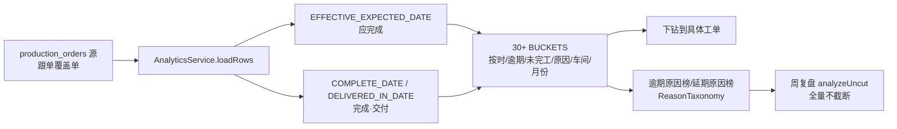

# 生产交期达成分析 与 周复盘分析 · 设计梳理

> 版本：2026-10-27　续《生产跟单设计梳理.md》的分析子模块专项梳理
> 范围：只梳理两个分析模块的设计，以及基于当前跟单数据的可扩展分析方向
> 依据：`ProductionTrackingAnalyticsService` / `ProductionTrackingWeeklyReviewService` / `ProductionTrackingReasonTaxonomy` / `ProductionTrackingSchedulePolicy` / `ProductionTrackingController` + 连库实测（2026-10-27）

---

## 0. 定位与范围（最重要的一条）

两个分析模块有一个共同地基：**它们统计的是「跟单覆盖的单」**（有跟单状态/节点记录的单，实测当前 **674 单**），**不是全量氚云源数据**（`production_orders` 共 6125 单）。

由此派生的两条硬约束：

1. **不统计全量源数据**。分析范围 = 有跟单记录的单，与"可见性收敛（跟单员 SELF / 主管 ALL）"同一口径。
2. **避开不可信时间**。氚云报工完工时间、采购入库时间**不作为**生产完成/交付的判定依据——生产进度以**跟单节点**为准。

> 为什么避开氚云报工：封口机车间在氚云只有一个制程「模具加工」，它 ≠ 整单生产完成（后面还有组装等）；其他车间制程虽多，但报工是"一堆机器一个文员统一报"，不是真实完工时刻。

---

## 1. 可信与不可信的时间点

分析能建在哪些时间点之上，取决于可信度。实测口径：

| 时间点 | 来源 | 可信度 | 分析用途 |
|---|---|---|---|
| 工单申请 / 任务单提交 | 业务侧 / 氚云同步 | ✅ 可信 | 周期起点、排产等待的起点 |
| 订单要求完成（业务员） | 业务员录入 | ✅ 可信 | 交付目标、交期紧张度 |
| 排产时间 | 跟单员排产动作 | ✅ 可信 | 生产起点、工期锚点 |
| 车间预计完成 | 跟单员协商 | ✅ 可信（可被协商调后） | 交付基准、协商延期幅度 |
| **跟单节点完成日期** | 跟单员实时跟 | ✅ **最可信的生产进度** | 节点漏斗、节点间耗时 |
| 氚云报工完工 | 氚云批量 | ❌ 不可信 | 仅作对照，不进分析判据 |
| 采购入库 | 采购侧 | ⚠️ 仅作对照 | 不反映生产完成时刻 |

> 交付判据说明：全站以 `DELIVERED_IN_DATE = COALESCE(warehouse_in_date, first_in)` 为唯一"已交付"判据，但**入库不反映"生产完成"时刻**——生产完成看跟单节点。这两个概念在分析中要区分。

---

## 2. 生产交期达成分析（`ProductionTrackingAnalyticsService`）

### 2.1 核心口径（代码已钉死，分析不回退）

| 口径 | 定义 | 备注 |
|---|---|---|
| 应完成日期 | `EFFECTIVE_EXPECTED_DATE = COALESCE(forecast_finish_date, expected_completion_date)` | 协商后预计优先；分析**不回退**业务员要求日 |
| 完成日期 | `COMPLETE_DATE = COALESCE(warehouse_in_date, first_in)` | 人工确认优先；未确认需同产品入库累计量达计划（QUANTITY_JOIN 窗口推断） |
| 交付基准 | `DELIVERY_BASELINE = COALESCE(forecast_finish_date, expected_completion_date, VALID_REQUIRED_DATE)` | 逾期判定的基准 |
| 交付结果 | `DELIVERY_OUTCOME`：PENDING / NO_BASELINE / ON_TIME / OVERDUE | 无基准单单独归 NO_BASELINE |
| 未跟过 | `NEVER_TRACKED = COALESCE(node_count, 0) = 0` | 从未录入节点的单单列 |
| 缺失应完成日 | `missingExpected` | 单独计数，提示补录 |

### 2.2 指标组织

- 一单一行（`loadRows`），按车间、月份、交期区间归桶；
- `BUCKETS`：30+ 指标桶，覆盖分类、分档、原因归类、车间维度；
- **原因归类**：逾期原因、延期原因各一套归类榜（`ReasonTaxonomy`）；
- **下钻**：每个桶都能下钻到具体工单明细，数字必须可追溯。

### 2.3 数据流（Mermaid）



---

## 3. 周复盘分析（`ProductionTrackingWeeklyReviewService`）

### 3.1 设计原则

- **不新造口径**：所有数字复用 `AnalyticsService.analyzeUncut`（不截断的原因榜），周复盘只负责"按周报的表格结构重组"，不另算指标。
- **按跟单员手写周报的结构组织**：

```
period（周期） → summary（本期总览）
  ├─ overdueTotal（逾期分母） → overdueLevels（分档） + overdueReasons（原因榜）
  ├─ extensionTotal（延期分母） → extensionReasons（延期原因榜）
  └─ workshops（车间维度）
```

### 3.2 原因归类（`ReasonTaxonomy`）

- 六类：**模具 / 配件 / 业务员 / 入库 / 组装 / 工期**；
- 机制：`classify`（关键词 contains 硬编码）→ `aggregate` → `keys()`；
- 逾期与延期各走一套归类，原文榜全量返回不截断。

### 3.3 快照固化（V419，已落地）

- 过去周期（toDate < 今天）首次被复盘时现算并**固化一次**，之后交期调整不再改变其数字；
- 当前/未来周期实时现算不入表；
- 快照表未建/读写失败自动降级回现算，现有功能零影响；
- 新增 `GET /manufacturing/followups/weekly-review/history` 供趋势看板（`TrackingReviewHistory.vue`）。

---

## 4. 口径铁律（两模块共用）

1. **应完成互斥闭合**：应完成 = 按期 + 逾期 + 未完工，三者不重不漏。
2. **延期 ≠ 逾期**：延期 = 车间预计被协商调后（相对业务员要求）；逾期 = 实际交付晚于交付基准（车间预计）。协商延期后仍可能逾期。
3. **完工判据用入库，不看报工**：氚云报工仅对照。
4. **不新造口径**：周复盘数字必须能在交期达成分析里对上。
5. **范围收敛**：只统计跟单覆盖的单，不拉全量源数据。

---

## 5. 现状数据质量（连库实测 2026-10-27）

> 以下数据支撑"哪些分析现在可做、哪些要等数据成熟"，并印证"延期原因词典表化暂缓"的判断。

| 维度 | 实测值 | 结论 |
|---|---|---|
| 跟单覆盖单数 | 674 单（约 11%） | 覆盖面仍小，分析代表性强弱待观察 |
| 节点完成漏斗（主链） | 备料 669 → 模具 638 → 组装 598 → 入库 592（涉及单 ~673/672/671） | 主链逐级递减，存在中间卡点/未标完成 |
| 按需工序 | 木箱 71/100、氧化 46/74 | 需按需工序完成率低，正常（非必走） |
| 每单完成节点数 | 448 单完成 5 节点（最多）、98 单 6、43 单 7 | 大多数单走到了主链尾部 |
| **节点间耗时** | **0 天 1401 次（主导）**、1 天 364、2 天 269 | **多数相邻节点同日补录，间隔区分度低**，暂不适合做精确"工序耗时" |
| 排产等待（提交→排产） | 主体 0–3 天（0 天 1294、1 天 1525、2 天 471） | 排产等待短且集中，可做异常识别 |
| 协商延期（原预计 − 要求） | 0 天占绝大多数，少量 2 天 40、4 天 33 等 | 目前延期协商少，预计多数贴着要求 |
| 延期原因 / 风险 | 延期原因仅 164 条、风险 0 条、下次跟进 0 条 | **原因类样本几乎为空，词典表化无依据** |

> 口径说明：排产等待、协商延期为覆盖单维度、经节点行关联放大后的分布形状，结论（"主体 0–3 天""多数预计=要求"）不受影响。

---

## 6. 可扩展分析方向（基于可信时间点，避开报工/入库）

按"数据是否已可信"排优先级：

### 现在就能做（吃源数据 / 跟单节点，数据可信）
1. **节点完成率漏斗**：主链（备料→模具→组装→入库）每步完成率，**识别卡点节点**（哪一步流失最多）——对排产、基准制定最有价值。
2. **排产等待异常**：提交→排产 >3 天的单单列，识别排产滞后。
3. **协商延期质量**：车间预计 vs 业务员要求，看延期协商幅度与是否仍逾期（延期是否解决问题）。

### 设计好、等数据成熟
4. **节点间耗时**：当前 0 天占比过高（同日补录），需等跟单员逐节点实时跟、间隔区分度上来后再做精确"工序耗时"。
5. **延期→逾期转化**：等延期原因数据积累后，分析协商延期后是否仍逾期、原因归类。

> 明确不做：排产→报工、报工→入库 等依赖氚云报工时间的间隔；以及全量源数据的周期统计。

---

## 7. 演进边界与后续

| 项 | 状态 | 说明 |
|---|---|---|
| 分析快照 + 趋势看板（⑤） | ✅ 已落地 | 历史周期固化、趋势可回看 |
| 节点漏斗 / 排产等待异常 | 建议下一步 | 现在就能做，数据可信 |
| 节点间耗时 | 待数据成熟 | 0 天占比过高 |
| 延期原因词典表化（④） | **暂缓** | 原因样本仅 164 条，过早固化无依据；等措辞稳定、覆盖上来再定表结构 |
| 权限最小化（⑥） | 待拍板 | 收敛 V403 给跟单员开的 template/baseline 全开 |

---

## 附：本次探查工具（只读）

- `tools/_probe_tracking_nodes.java`：连库只读探查源（可复现第 5 节所有数字），未改动任何数据。
