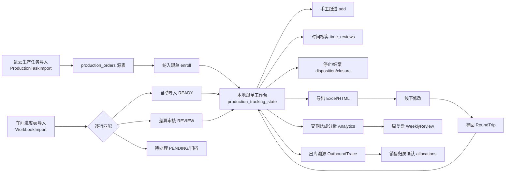

# 生产跟单模块设计梳理（LQXM）

> 本文档基于对代码与迁移脚本的梳理，全面还原「生产跟单」模块的定位、数据模型、业务流程、权限模型与技术要点。
> 梳理范围：后端 `ProductionTracking*` 服务/控制器、前端 `apps/archive/views/production/` + `composables/tracking/` + `components/production/`、数据库迁移 V328~V407 相关脚本。

---

## 一、模块定位与设计原则

**定位**：生产跟单是建立在「氚云生产任务单（`production_orders`）」之上的**本地规划、沟通与复盘层**。它不是生产执行的权威来源，而是跟单员围绕氚云工单做推进、登记延期、核对进度的辅助工作台。

**核心铁律（贯穿全模块）**：
1. **不改氚云源事实**：跟单绝不修改 `production_orders` 的报工状态、完成时间、数量等源字段；所有本地处置（延期、停止、结案）都写独立表。
2. **不虚构报工**：报工仍是工序完成的唯一权威来源；本地补录（如早期 `manual_completed_date`）不触发下游解锁。
3. **可追溯**：每次跟进/修订都写 `before_json / after_json` 版本化历史，只增不改。
4. **可见性收敛**：跟单员只能看到并操作本人名下（或未分配）的任务，主管看全部。

> 设计演进上，跟单先后经历了「绑本地 `manufacturing_orders`」→「独立 `production_followup_records`」→「绑氚云 `production_orders`」三个阶段（见第九章时间线），最终收敛为「氚云工单 + 本地跟单快照」的形态。

---

## 二、数据模型

### 2.1 核心表总览

| 表 | 职责 | 关键字段 |
|---|---|---|
| `production_orders` | 氚云生产任务主表（**源数据**，外部来源 H3YUN） | work_order_no、product_name、production_line、expected_completion_date、required_completion_date、schedule_time、optional_configuration、status、required_quantity |
| `production_tracking_state` | **跟单当前状态快照**（每工单一行） | planned_start_date、forecast_finish_date、risk_category、delay_reason、next_followup_date、assignee_*、version、last_followup_at、delivery_result、shipment_status、remark、stopped_*（V388）、closed_*（V389） |
| `production_tracking_entries` | **跟单历史**（只增不改） | production_order_id、version、content、before_json、after_json、created_by_*、created_at |
| `production_tracking_milestones` | **本地跟单节点** | (production_order_id, stage_code) 联合主键、stage_status(PENDING/IN_PROGRESS/DONE)、completed_date、note |
| `production_tracking_enrollments` | **跟单纳入范围**（显式工作队列） | production_order_id、origin(MANUAL/...)、enrolled_at |
| `production_tracking_time_reviews` | **时间核实与交期协商记录** | kind(ACCEPTANCE/COMMITMENT/REPORTING/WAREHOUSING)、status(OPEN/RESOLVED/ON_TIME/NEGOTIATED)、reason、agreed_date、next_followup_date、source_due_date、source_expected_date |
| `production_tracking_workbook_rows` | **车间进度表导入行**（逐行核对） | sheet_name、sheet_row、source_hash、source_order_no、product_name、required_completion_date、payload_json、match_status、production_order_id、match_note |
| `production_tracking_node_benchmarks` | **车间级节点参考基准** | workshop_kind(SEALER/MACHINE)、stage_code、typical_days、sample_count、baseline_note、computed_at |
| `production_tracking_duration_groups` | 产品工期分组 | group_name、workshop_kind |
| `production_tracking_product_benchmarks` | **产品级节点参考基准**（人工发布值优先） | duration_group_id、stage_code、typical_days(审核发布)、p50/p75、sample_count、excluded_count、baseline_note |
| `production_tracking_column_defaults` | 列表默认可见列（全站配置） | column_key、visible |
| `production_outbound_allocations` | **销售归属确认**（入库→出库核对） | production_order_id、purchase_receipt_item_id、sales_outbound_item_id、allocated_quantity、receipt/sale 快照、request_key、status(ACTIVE/REVOKED)、confirmed_by_* |
| `manufacturing_task_config_items` | 任务单配置（氚云下拉字典镜像） | workshop_id、config_name、config_type(PRODUCT_NAME/OPTIONAL_CONFIG)、external_source |
| `manufacturing_workshops` | 生产车间主数据 | workshop_name、enabled、order_receiver_name、warehouse_clerk_name |

### 2.2 关系与定位

```
氚云源层:  production_orders (生产任务)   ──┬── production_outbound_allocations (销售归属)
                                           │
本地跟单层: production_tracking_state (状态) │
           ├─ entries (历史)                │
           ├─ milestones (节点)             │
           ├─ enrollments (纳入)            │
           ├─ time_reviews (时间核实)       │
           └─ workbook_rows (进度表导入)     │
基准层:    node_benchmarks (车间级)          │
           duration_groups + product_benchmarks (产品级)
```

---

## 三、核心业务概念

### 3.1 车间与节点（Milestone）

- 按车间分两套节点序列（`ProductionTrackingPolicy`）：
  - **封口机**（`isSealer(workshop)`，车间名含「封口」）：`备料 → 模具生产 → 氧化/喷特氟龙 → 组装 → 入库 → 木箱`
  - **机器车间**（气调机等）：`画图 → 备料 → 钣金 → 模具 → 组装 → 调试 → 入库 → 木箱`
- **按需工序**（`OXIDATION` 氧化、`WOODEN_CRATE` 木箱）：工单可选配置写明需要或已有跟单记录才适用；未选择的**不计入进度分母**。
- **必经节点** = 全部节点去掉按需工序；**「跟单完成」只看必经节点是否全部 DONE**。
- 交期口径终点 = **入库（WAREHOUSE）**；入库后的节点（木箱）不参与交期倒排与预测完成（SchedulePolicy 的 `deliveryStages`）。

### 3.2 时间口径

跟单围绕三个时间节点做 deadline 判断：
- **排产时间 `schedule_time`**（氚云导出补列，V373）：确认是否开工。
- **当前有效预计**：`COALESCE(forecast_finish_date, expected_completion_date, valid_required_date)` —— 跟单员修订的延期日至上、车间预计完成、订单要求完成日逐级回退。
- **整单完工日**（分析专用）：人工确认优先；未确认时须「同产品累计入库量 ≥ 计划量」才推定完成（`COMPLETE_DATE`）。

### 3.3 状态与动作

列表里由 `TRACKING_STATUS_CASE`、`REMINDER_CASE`、`TRACKING_ACTION` 派生三类信号：
- **跟踪状态**：`stopped / finished / in_progress / not_started / pending` 等。
- **提醒**：按「已停止/已完成/有风险/待跟进/需关注/正常」分档。
- **跟单动作**：`FINISHED_PENDING / INBOUND_PENDING / ...`（待入库、待跟单等，提示下一步该做什么）。
- **本地处置（与氚云解耦）**：`stopped_at`（停止跟单，V388）、`closed_at`（结案，V389，结案优先覆盖为「跟单已完成」，与节点是否齐全解耦）。

---

## 四、角色与权限模型

### 4.1 可见性判据

**生产跟单的可见性唯一判据 = 角色在 `MANUFACTURING` 功能上的数据范围**（`system_role_feature_grants.data_scope`，V372 确立）：
- `ALL` → 看全部跟单（生产跟单主管 / ADMIN / BOSS）
- 其余 → 只看**本人名下 + 未分配归属**的跟单（生产跟单员 / 车间报工）

执行层再按 `@RequirePermission` 的三档读权限（`read.self/department/all`，任一即可）放行接口与菜单。

### 4.2 角色

| 角色 code | 角色名 | MANUFACTURING 数据范围 | 说明 |
|---|---|---|---|
| `PRODUCTION_TRACER` | 生产跟单员 | SELF | 跟单推进者，V372 由「生产跟单」改名并收窄 |
| `PRODUCTION_TRACKING_SUPERVISOR` | 生产跟单主管 | ALL | V372 新增，成员由管理员配置 |
| `SHOPFLOOR_REPORTER` | 车间报工 | SELF | V337，范围与全局对齐 |
| `PRODUCTION_MANAGER` | 生产管理 | — | 有跟单写权限 |
| `ADMIN / BOSS` | 系统管理员/老板 | ALL | 全量 |

### 4.3 权限码

| 权限码 | 用途 | 授予 |
|---|---|---|
| `manufacturing.read.self / .department / .all` | 跟单读（列表/详情/分析） | 按数据范围展开 |
| `manufacturing.followup` | 跟单写入（跟进/补录/时间核实/停止/结案/导入） | 跟单员/主管/生产管理/Admin/BOSS |
| `manufacturing.template.manage` | 「生产参考工期」页与任务单配置门槛 | V224 起授予，V403 开放给跟单员 |
| `manufacturing.baseline.manage` | 节点参考基准天数配置 | V383 仅 Admin；V403 开放给跟单员 |
| `manufacturing.listcolumns.manage` | 列表默认列配置 | 仅 Admin |

> 配置层（`system_role_feature_grants`）与执行层（`system_role_permissions`）必须同步写入，否则角色权限页一保存即漂移（V372/V403 的教训）。

---

## 五、业务流程



### 5.1 数据进入：氚云生产任务导入
`ProductionTaskImportController`（`/api/manufacturing/followups/production-task-import`）是跟单员的生产任务单专用入口，**复用氚云导入中心**（`H3FactImportService`）：stage（哈希去重）→ 异步解析 → preview → confirm，写 `production_orders`。`h3_import_rows` 保留原始快照，可随批次追溯。

### 5.2 纳入跟单（enroll）
跟单是**显式工作队列**，不是每个导入的工单都跟。`enroll` 写入 `production_tracking_enrollments`，标记该工单进入跟单范围。V370 前已跟单的任务自动补录纳入。

### 5.3 车间进度表导入（WorkbookImport）
`ProductionTrackingWorkbookImportService` 认**氚云进度表模板**（固定 sheet 名、表头第 2 行、阶段名第 3 行、行 4 起，列按表头文字定位，模板增删列不静默读错）。
- 逐行按「产品名 + 车间 + 交期 + 编号 + 数量」五字段归一化匹配 `production_orders`，唯一命中才自动导入。
- 匹配结果分档：`READY`（新工单自动导入）/ `UPDATE`（仅有表格记录，差异可随导入更新）/ `EXISTING`（内容相同）/ `REVIEW`（已有人工跟进，差异待主管确认）/ `ARCHIVED`（命中归档规则）/ `PENDING`（无法唯一匹配）。
- 文件 SHA-256 + `planHash`（匹配计划指纹）双重校验，文件或库内状态变化即要求重新预览。
- 差异确认（`WorkbookReviewService`，仅主管）只认四类可写：延期至、延期原因、各节点完成日期。

### 5.4 手工跟进（add）
`add` 是**唯一的手工跟单写入路径**（授权 → 版本校验 → 状态 upsert → 节点 upsert → 历史追加 → 审计）。导回（RoundTrip）也复用这条路径，保证可追溯。

### 5.5 时间核实（time_reviews）
`production_tracking_time_reviews` 覆盖四类交期问题（ACCEPTANCE 受理 / COMMITMENT 承诺 / REPORTING 报工 / WAREHOUSING 入库），支持协商 `agreed_date` 与下次跟进日期。修改某类最新一条用 `updateTimeReview`（不新增历史，审计留原文）。

### 5.6 停止 / 结案
- **停止**（disposition）：跟单员可暂停某单跟单，`stopped_at/stopped_reason/stopped_by`。
- **结案**（closure）：跟单员可在节点未全完成时主动确认结束，`closed_at/closed_by/closed_note`，结案优先覆盖为「跟单已完成」。两者互斥、均不改氚云。

### 5.7 导出 → 线下改 → 导回（RoundTrip）
- **导出**：`/export` 支持 Excel / HTML 两种格式，按当前筛选条件导出全部行（上限 5000），与列表同一可见性/取数口径。中文文案只在前端。
- **导回**：`RoundTripService` 认**本系统导出的 Excel**，按「任务号」精确匹配；只回写跟单员维护的四类字段（跟单备注/车间预计完成=延期至/延期原因/各节点完成日期），**空白=不修改**。写入一律复用 `add`。

### 5.8 出库溯源 + 销售归属（OutboundTrace）
`ProductionOutboundTraceService` 把工单 → 采购入库 → 销售出库串成核对链路：
- 列表汇总：已收数量、已确认归属数量、失效（stale）归属、多单位、出库覆盖截止日。
- 确认归属：`production_outbound_allocations` 记录「入库明细 + 出库明细 + 数量 + 双方快照」，带 `request_key` 幂等、`FOR UPDATE` 行锁、可分配量校验、出库日期不得早于入库。
- 覆盖截止日提示：出库台账最新日期之后暂无出库记录，确认数为 0 不代表未销售。

### 5.9 分析（Analytics）+ 周复盘（WeeklyReview）
- **交期达成分析**（`ProductionTrackingAnalyticsService`）：一单一行，按车间/月份聚合，产出 30+ 指标桶（按时/逾期/未完工/延期/提前/原因缺失/来源分类等），支持下钻到具体工单。
- **原因归类**（`ProductionTrackingReasonTaxonomy`）：自由文本延期/逾期原因 → 六类（模具/配件/业务员/入库/组装/工期），匹配顺序精确度优先，展示顺序主因在前。
- **周复盘**（`WeeklyReviewService`）：把分析数字按「周报写法」重组，**不新造口径**（复用 analyzeUncut 全量原因，归并不丢单）。

---

## 六、参考工期（基准）

跟单的「预计完成/工期倒排」由两级基准推算：

- **车间级**（`production_tracking_node_benchmarks`）：每车间类别 × 节点的「一般耗时」（天），由真实完成日期**中位数**试算（封口机 2026-10 实测：备料 0 天 / 模具 3 天 / 组装 2 天 / 入库 0 天）。
- **产品级**（`production_tracking_product_benchmarks` + `duration_groups`）：按产品分组的节点间隔，人工审核发布值（`typical_days`）优先，空值回退车间基准；提供 P50/P75 候选、样本明细、批量应用、跨产品复制。
- **链式推算**（`ProductionTrackingSchedulePolicy`）：上游锚点（排产时间）+ typical_days 正向预测完成日，deadline 反向倒排各节点目标日，输出 `latestStartDate / predictedFinishDate / slackDays / risk`。交期口径终点 = 入库。缺少间隔时不猜测。
- **唯一匹配**：产品级基准要求「车间 + 产品名」恰好一行配置，重名歧义回退车间基准，覆盖率据此统计。

---

## 七、前端结构

| 路由 | 视图 | 权限 | 导航 |
|---|---|---|---|
| `/production-tracking` | `ProductionTrackingView.vue`（列表 + 分析抽屉 + 周复盘抽屉 + 进度表导入 + 导出/导回） | `manufacturing.read.*` | 「生产跟单」 |
| `/manufacturing-task-configs` | `ManufacturingTaskConfigView.vue`（车间/任务单配置 + 参考工期 + 覆盖率） | `manufacturing.template.manage` | 「生产参考工期」 |

**关键组合式函数（composables/tracking/）**：`useTrackingFilters`（筛选）、`useTrackingExport`（导出）、`useTrackingListColumns`（列默认）、`useTrackingWorkbook`（进度表导入闭环）、`useTrackingRoundTrip`（导回）、`useTrackingListCompletion`（完成度）、`useTrackingBatchClosure`（批量结案）。

**核心组件（components/production/）**：`TrackingDetailDrawer`（详情）、`ProductionTrackingAnalyticsDrawer`（分析）、`ProductionTrackingWeeklyReviewDrawer`（周复盘）、`TrackingProductBenchmarkPanel` / `ProductBenchmarkSamplesDrawer`（产品基准）、`ManufacturingTaskConfigPanel`、`ProductionTaskImportDialog`、`CoverageBreakdownDrawer`（覆盖率）、`TrackingSourceDetailDrawer`（来源明细）。

列表默认可见列由 `production_tracking_column_defaults` 全站配置（仅管理员），员工可自行勾选覆盖，列 key 前后端由契约测试钉死。

---

## 八、技术要点

- **幂等**：所有写路径（跟单/导回/导入/归属确认）统一 `IdempotencyService` + `request_key`（X-Request-Key）。
- **版本化并发控制**：`production_tracking_state.version` + `production_tracking_entries` 唯一版本号，乐观校验避免覆盖。
- **审计**：每次变更写 before/after JSON 快照进 entries；归属确认/撤销记录操作人。
- **行级可见性**：`appendVisibility` 统一追加 SQL 条件，禁止各 Service 自写私有 scope。
- **性能**：V399 补覆盖索引（`production_orders` 排序列、`sales_outbounds.business_date`），首屏 440ms→3ms；`outboundCoverageThrough` 全表缓存 + 5 分钟 TTL。
- **同步范围收敛**：进度表/导回只认跟单员维护的字段，源数据列（交付结果/发货状态/数量等）改了一律忽略，防止导出件成为绕过氚云源数据的后门。
- **数据清理**：`active` 列（V400）、制程模板/工序库（V406）等无用概念已下线，只保留「产品 + 车间 + 历史任务 + 参考工期」真实业务。

---

## 九、设计演进时间线

| 版本 | 演进 |
|---|---|
| V328 | 本地订单表跟单雏形：`manufacturing_orders` 快照列 + `manufacturing_order_follow_ups` 日志 + 工序补录 |
| V329 | 独立 `production_followup_records/logs`（外部来源标识，重导不覆盖） |
| V360 | `production_tracking_state/entries`，基于 manufacturing_orders |
| V366 | **关键转折**：迁移到氚云 `production_orders`，旧表归档 legacy |
| V369 | 里程碑节点 + 交付结果/发货状态/备注 |
| V370 | 纳入范围 enrollments + 车间进度表 workbook_rows |
| V371 | workbook 多版本 source_hash + 跟单员按车间分配 |
| V372 | **角色拆分**：跟单员 SELF / 跟单主管 ALL / 车间报工 SELF |
| V373 | 排产时间 schedule_time |
| V377 | 时间核实 time_reviews |
| V382 | 车间级节点基准（中位数播种） |
| V383 | baseline.manage 权限（仅管理员） |
| V386 | 模块查看权限（查看即权限） |
| V387 | 列表默认列全站配置 |
| V388 / V389 | 停止处置 / 结案 |
| V391 | 产品工期分组 + 产品级基准 |
| V399 | 列表索引优化 |
| V400 | 删 task_config active 列 |
| V401 | 车间级基准恢复（全量提交清空事故） |
| V403 | 跟单员开放 template.manage + baseline.manage |
| V406 | 移除 legacy 制程主数据 |
| V407 | 幂等独立 schema |

---

## 十、已知边界与取舍

1. **不改源**是硬边界：本地停止/结案/延期都不影响氚云生产任务单的原始状态，跨系统状态需靠跟单快照对齐。
2. **「未完工」是现状而非历史快照**：交期调整后任务会在分析区间之间移动，回看过往周期数字会变（前端有提示）。
3. **参考工期为派生值**：`typical_days` 是真实数据中位数/人工发布，缺样本的车间/产品不推算、不猜测。
4. **重名即回退**：产品配置重名时不猜，回退车间基准并暴露警告。
5. **车间进度表只同步跟单字段**：源数据列不在同步范围，避免绕过氚云。
6. **覆盖率统计 ≠ 基准命中**：历史任务数 ≠ 基准样本数，两列同屏展示防误读。

---

*梳理时间：2026-10-27。本文档为只读梳理产物，未改动任何代码。*
